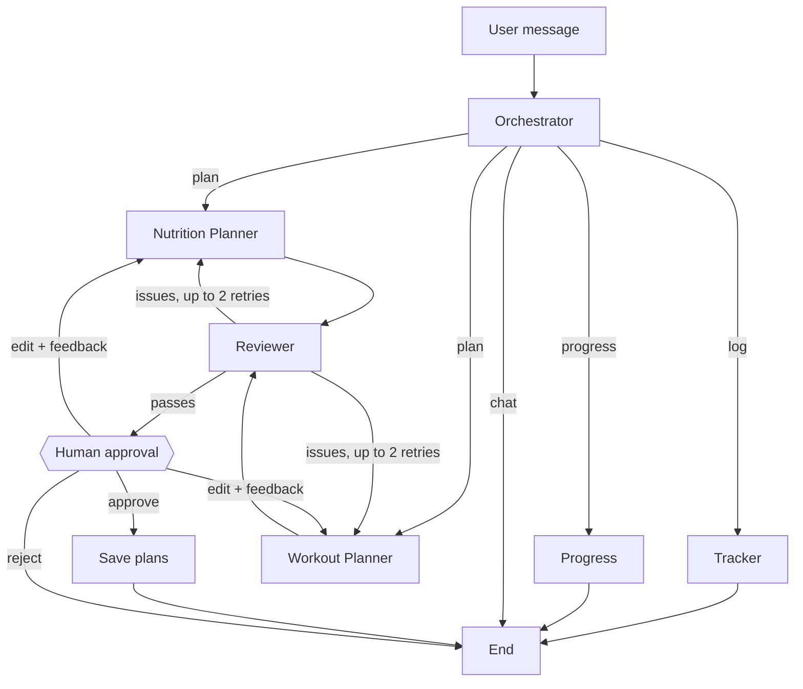

# Fitness Agents

A multi-agent fitness tracker for CIS 4394 (Agentic AI). Log meals, water, weight, runs and lifts in plain English, and get meal and workout plans built around your goals, your preferences, and your weakest lifts.

Built with **LangGraph** (agent orchestration) and **Claude** (via the Anthropic Python SDK).

> This is a class project, not medical advice.

## Setup

Requires [uv](https://docs.astral.sh/uv/) (`brew install uv`).

```bash
cd ~/fitness-agents
uv sync
cp .env.example .env      # then add your ANTHROPIC_API_KEY (and optionally a USDA key)
uv run fitness-agents
```

- **Anthropic API key:** https://platform.claude.com → Settings → API Keys (API usage is billed separately from a Claude.ai subscription)
- **USDA FoodData Central key (free):** https://fdc.nal.usda.gov/api-key-signup. `DEMO_KEY` works but is rate-limited to about 30 requests an hour.

Run the tests (no API key needed; the LLM is faked):

```bash
uv run pytest
```

## Example session

```
you> had 2 scrambled eggs and a banana, drank 20 oz water
agent> Logged 2 scrambled eggs (~100 g): 149 kcal
       Logged banana (~118 g): 114 kcal
       Logged 20 oz water
       Today: 263 / 2473 kcal | protein 11/160 g | ...

you> bench 185 for 5
agent> Logged bench 185x5
       New estimated bench max: 215.8 lb

you> make me a full plan
       (meal plan and workout plan are drafted in parallel, checked by the Reviewer, then shown)
[a]pprove, [e]dit, or [r]eject? e
What should change? no oatmeal, I hate it
       (the Nutrition Planner redrafts using that feedback)
```

## Architecture

| Agent | Role | LLM? |
|---|---|---|
| **Orchestrator** | Classifies each message (log / meal plan / workout plan / full plan / progress / chat) and routes it | yes (low effort) |
| **Tracker** | Turns free text into structured logs; looks up calories in USDA FoodData Central; updates max lifts from logged sets | yes, for parsing only |
| **Nutrition Planner** | One-day meal plan that hits the calorie and macro targets using foods the user likes | yes |
| **Workout Planner** | Weekly schedule that prioritizes the user's weakest lifts | yes |
| **Reviewer** (critic) | Hard safety rules in code plus an LLM critique; sends failing plans back for another draft | rules + LLM |
| **Progress** | 30-day summary: weight and BMI trend, average intake, runs and pace, maxes | no (pure code) |



### Design choices

- **Math stays in code, not in the LLM.** BMI, Mifflin-St Jeor BMR/TDEE, calorie targets, macros, Epley 1RM, and strength ratios are in `calc.py` and unit tested. Meal plan totals are recomputed from the items instead of trusting the model's sums.
- **Calories come from real data.** The Tracker gets values from USDA FoodData Central. It only falls back to the LLM's estimate when there's no match, or when the match is clearly wrong (more than 2× off from the estimate). Every log entry records its source.
- **Hard safety limits.** A calorie floor (1500 kcal for men, 1200 for women), weight change capped at 1% of body weight or 2 lb a week, a required rest day, and caps on sets per muscle. These are enforced in code, so the model can't argue past them.
- **Parallel agents.** For a full plan, the Nutrition and Workout Planners run at the same time, and the Reviewer waits for both.
- **Feedback loop.** The Reviewer sends only the failing plan back, with its specific issues, up to `MAX_REVISIONS` times.
- **Human in the loop.** The graph pauses (LangGraph `interrupt`) and nothing is saved until the user approves. Edits go back to the right planner along with the user's feedback.
- **Ambiguous input.** The Tracker asks a clarifying question instead of guessing (for example, "some pasta").
- **Long history stays out of the prompt.** Logs live in SQLite, and agents get only the summaries they need.
- **Structured outputs.** Every LLM call returns a validated Pydantic object, so there's no JSON parsing that can break.

## Project layout

```
src/fitness_agents/
  cli.py              command-line chat, onboarding, approval prompt
  graph.py            LangGraph workflow (routing, review loop, human approval)
  state.py            shared state passed between agents
  agents/             orchestrator, tracker, nutrition_planner, workout_planner, reviewer, progress
  calc.py             fitness formulas and safety limits
  nutrition_api.py    USDA FoodData Central lookup + cache
  db.py               SQLite storage
  llm.py              Anthropic SDK wrapper (structured outputs)
tests/                unit tests and a full-workflow test with a fake LLM
```

## Next steps

- Web front end on GitHub Pages, backed by a small FastAPI server hosted elsewhere (Pages can't run Python or hold an API key)
- Charts for weight, BMI, and calorie trends
- Exercise database (wger) for exercise alternatives
- Evaluation: compare Tracker calorie estimates against USDA values on a fixed set of meals
